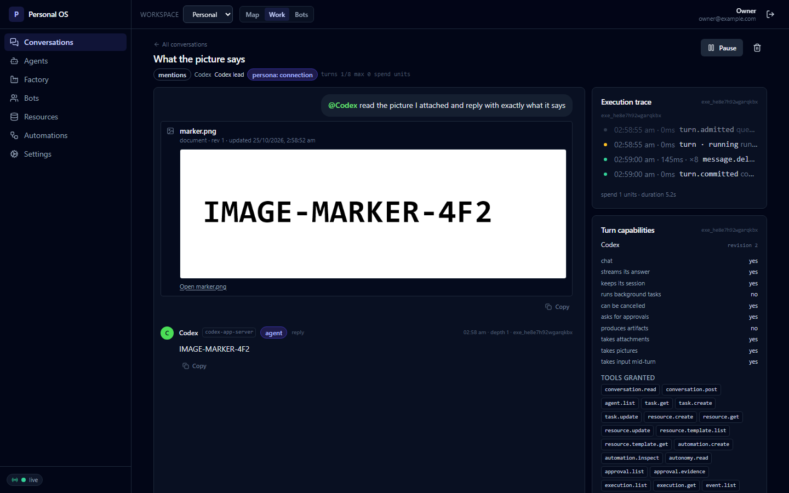

# The room shows the picture, and the agent reads it

**Date:** 2026-10-25 · **Runtime:** Codex 0.163.0, over its App Server · **Room:**
`cnv_xfj71vzvnxhg4axb` · **Connection:** `agt_njxvdtuaxpucl68d` · **Slice:**
[SPEC-R1-5](spec/r1-5-content-images.md)

It settles one thing: **a picture the owner attaches reaches the runtime, and
the room shows it.** The owner attached a picture, the agent read it and
answered from it, and the transcript carries the picture itself rather than a
row that says a file's name.

## What was asked

The rich-chat checklist names _files/images_. The file half was delivered with
the third slice; the picture half was not, and the adapters' matrix said so in
its own words:

> The part carries the file's content as text, so a file whose bytes are not
> text cannot be carried. The protocol has an `image` block that takes bytes,
> and that mapping is its own work.

So the gap was known, named and unfinished, and this run closes it.

## The picture

One PNG, 900×300, with one word on it:



_the picture, as the room shows it: the words `IMAGE-MARKER-4F2`, and the file's
own row — `marker.png`, `document · rev 1` — above it._

The marker is in the picture and nowhere else. The agent's answer can therefore
only come from the picture: nothing else in the room says `IMAGE-MARKER-4F2`.

## The owner's run

The room is the product's own: the connection was made in the panel from the
`codex-app-server` template, and the picture was attached with the panel's own
upload button.

```
STEP 1 signed in
STEP 2 the connection was created: agt_njxvdtuaxpucl68d
STEP 2 the connection says it can carry pictures: true
STEP 3 the room was opened: cnv_xfj71vzvnxhg4axb
STEP 4 the composer says: What the picture says | Uploaded marker.png.
STEP 5 the agent answered: true
STEP 6 the room shows the marker: true
STEP 6 the room shows the picture itself: true (1 image element(s))
```

The message the room stored carries the picture as the contract publishes it:

```json
[
  {
    "type": "text",
    "text": "@Codex read the picture I attached and reply with exactly what it says"
  },
  {
    "type": "image",
    "resourceId": "res_jf6wzj0ky73p0qgy",
    "displayName": "marker.png",
    "mimeType": "image/png",
    "url": "/api/resources/res_jf6wzj0ky73p0qgy/content"
  }
]
```

and the agent's answer is the marker:

```json
[{ "type": "text", "text": "IMAGE-MARKER-4F2" }]
```

**The room serves the picture's own bytes**, from the resource the message
points at:

```
the picture's url: /api/resources/res_jf6wzj0ky73p0qgy/content
the room serves the picture: 200 (image/png, 8877 bytes)
```

The turn's trace, as the owner sees it:

```
02:58:55 am · 0ms      turn.admitted queued
02:58:55 am · 0ms      turn · running running
02:59:00 am · 145ms · ×8  message.delta message.completed · 32 chars
02:59:00 am · 0ms      turn.committed committed
spend 1 units · duration 5.2s
```

And the panel says what the route can do — the new row is there, next to the
one about files:

```
takes attachments   yes
takes pictures      yes
takes input mid-turn yes
```

## What the demonstration found

**The route's schema had drifted from the contract.** The first run of this
demonstration uploaded the picture and then refused to send the message. The
browser showed nothing; the API log said:

```
POST /api/conversations/cnv_…/messages   422
```

and the error was:

```json
{
  "error": {
    "code": "validation_failed",
    "message": "The request payload is invalid.",
    "details": { "fieldErrors": { "content": ["Invalid input"] } }
  }
}
```

The route validated the message against **its own three-part union** — text,
artifact and file — while the contract had grown an attachment and an image.
The contract is the single source of truth for every shape that crosses a
boundary, and the route had kept a copy of it instead of using it, so the copy
was stale. **The fix is in the route**: it now validates against the contract's
own `contentPartSchema`, and a test says so for every part the contract
publishes.

The drift was older than this slice. The `attachment` kind had been in the
contract since the third slice, and the route had been refusing it too — the
panel never sent one, so nobody noticed.

**The fix is in this slice, and it landed before this transcript.** The route
takes the contract's shape; the picture's own path is unchanged.

## The runtime's half, measured first

The route's choice between the protocol's two image shapes was not a matter of
taste, because the runtime accepts both. A probe drove the installed Codex
0.163.0 through each shape in turn, with one picture — the PNG above — and
asked it to read it:

| Shape the route could send                      | What the runtime answered |
| ----------------------------------------------- | ------------------------- |
| `{type:'image', url:'data:image/png;base64,…'}` | `IMAGE-MARKER-4F2`        |
| `{type:'localImage', path:'…/marker.png'}`      | `IMAGE-MARKER-4F2`        |

Both work. The product's own rule then decided which one the route sends:

> The content is in the part, not a reference to it: an adapter is given a
> resource id it cannot follow, and a path it cannot open.

A `localImage` path is a reference to the runtime's machine's filesystem. The
App Server route spawns the runtime locally, so the path would work — and it
would stop working the moment a runtime runs somewhere else. **The bytes
travel**, as an image by url.

## The limits

What this run does **not** show, stated plainly:

- **The ACP route against a real runtime.** The gate drives that route's built
  adapter and checks the prompt it builds, and the shape is the protocol's own
  `image` block. The runtime's half could not be demonstrated: the installed
  OpenCode's free allowance was spent — its own log says
  `AI_APICallError: Free usage limit reached` — so every prompt it was given
  failed the same way, including a direct `opencode run` and a probe that does
  not touch the product's code at all.
- **A picture larger than the request can carry.** The bytes travel inline, so
  a picture's size is a request's size. The product has no size policy for
  attachments today, and this slice does not invent one.
- **Audio and video.** The protocol has shapes for both; the product has no
  capture path for them and the rich-chat checklist names pictures.
- **A file that is neither text nor a picture.** A PDF, an archive, an
  executable: still left out, with the true reason.

## What a reader can re-run

- `npm run verify:content-images` — the gate, on any machine, with no runtime
  and no account.
- `npm test -w @personal-os/agent-adapters -- content-images` — the routes'
  own tests.
- `npm test -w @personal-os/worker -- content-parts` — the resolver's own
  tests.
- `npm test -w @personal-os/server -- content-parts` — the route's own test, for
  the parts the contract publishes.
