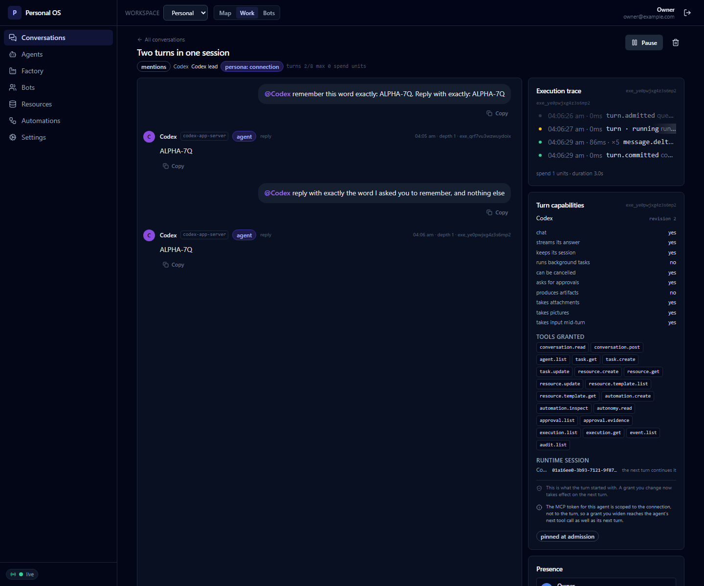

# The room holds two turns, and the second one is about the second question

**Date:** 2026-10-25 · **Runtime:** Codex 0.163.0, over its App Server · **Room:**
`cnv_bz2rburn8e6p8h4s` · **Connection:** `agt_3kripr9h6c59t2ti` · **Slice:**
[SPEC-R1-6](spec/r1-6-two-turns-one-session.md)

It settles one thing: **a turn's work is the turn's own, on every route, and the
room can hold a conversation.** The owner asked twice, the runtime answered
twice, and the second answer was about the second question — and about the word
the runtime had been given in the first turn, which the second question did not
carry.

## What was asked

Two questions, and the second one is the one that matters. It asks for a word
the _first_ turn gave the runtime, and it carries no history of its own: only
the runtime's own thread can answer it.

```
@Codex remember this word exactly: ALPHA-7Q. Reply with exactly: ALPHA-7Q
@Codex reply with exactly the word I asked you to remember, and nothing else
```

So the run proves two different things at once. If the route let the thread's
history into the turn, the second answer would carry the first answer with it —
the marker twice, not once. And if the runtime had forgotten the thread, the
second answer would be "NONE", and the conversation would have been two
prompts that share a page.

## The room



_the room after the second turn: the owner's two questions and Codex's two
answers, the trace of the turn that is running, and the runtime session the
room publishes._

The panel on the right is the room's own account of the turn:

```
RUNTIME SESSION
Codex  01a16ee0-3b93-7121-9f87…  the next turn continues it
```

and the trace carries the second turn's own work:

```
04:06:26 am · 0ms    turn.admitted queued
04:06:27 am · 0ms    turn · running running
04:06:29 am · 86ms · ×5  message.delta message.completed · 7 chars
04:06:29 am · 0ms    turn.committed completed

spend 1 units · duration 3.0s
```

Seven characters: `ALPHA-7Q`. The first turn's answer was seven characters too,
and the second turn's answer is not the first turn's answer with the first
turn's answer in front of it.

## The owner's run

The room is the product's own: the connection was made in the panel from the
`codex-app-server` template, and the two questions were typed into the room's
own composer.

```
STEP 1 signed in
STEP 2 the connection was created: agt_3kripr9h6c59t2ti
STEP 2 the connection says it keeps sessions: true
STEP 3 the room was opened: cnv_bz2rburn8e6p8h4s
STEP 4 the first turn answered: true
STEP 5 the second turn answered: true
STEP 6 the agent's message msg_b8wasov30ldziera: [{"type":"text","text":"ALPHA-7Q"}] · the marker appears 1 time(s)
STEP 6 the agent's message msg_ctnopko3nld8cf3k: [{"type":"text","text":"ALPHA-7Q"}] · the marker appears 1 time(s)
STEP 6 the second answer carries the marker 1 time(s); the thread's earlier answer is not this turn's work
STEP 6 the room publishes the session: 01a16ee0-3b93-7121-9f87-4c9567b586c8 · continuity resumable · connection agt_3kripr9h6c59t2ti
STEP 6 the room shows the marker 4 time(s) in total
```

**One thread, two turns.** The room publishes the session it is talking to, and
its continuity is `resumable`: the next turn continues it. The second turn ran
in the thread the first turn ran in, and the runtime answered from its own
memory of that thread.

## The runtime's half, measured before the room was asked

The room is the product's half. The runtime's half was measured first, with two
probes against the installed Codex 0.163.0, because the rule is worth nothing
unless the runtime behaves the way the rule assumes.

**The resume replays nothing.** The probe drove the App Server through two
turns in one thread and recorded every notification with the time it arrived:

```
first turn:  "FIRST-TURN-OK"
resume:      0 deltas
second turn: "SECOND-TURN-OK"
```

The second turn's answer was its own. And at the resume the runtime said why:

> Full-history hydration is deprecated for paginated threads; use
> `excludeTurns: true`, then page with `thread/turns/list` and
> `thread/items/list`.

So the history is available to a client that asks for it, and the runtime is
moving the way to ask for it. The route does not depend on the runtime's
current behaviour: it holds the rule against a runtime that replays.

**The runtime names its turns.** The App Server's own notifications say which
turn they belong to, and the id is the one the answer to `turn/start` named:

```
turn/started              :: turn.id = 01a16ec7-15a4-…
item/started              :: turnId = 01a16ec7-15a4-…
item/completed            :: turnId = 01a16ec7-15a4-…
item/agentMessage/delta   :: turnId = 01a16ec7-15a4-…
turn/completed            :: turn.id = 01a16ec7-15a4-…
```

**The second turn kept the runtime's own memory.** A probe asked the thread,
with no history in the prompt at all, for the word it had been told to remember:

```
first turn:  "Remember this word exactly: FIRST-TURN-OK. Reply with exactly: FIRST-TURN-OK"
second turn: "Reply with exactly the word I asked you to remember in my previous message, or NONE if you do not remember it."
answer:      "FIRST-TURN-OK"
```

The answer cannot have come from the prompt — the prompt held only the question.
It came from the thread the runtime kept. **A follow-up restores the runtime's
native context**, and the product does not have to carry it.

## What the room would have shown without the fix

The guard was taken out of the route, the package was rebuilt, and the same
question was asked in a browser — against the repository's own App Server
double, told to hand the thread's history back. The second answer read:

```
APP-SERVER-OK turn 1APP-SERVER-OK turn 2
```

The owner's turn held the earlier answer and the new one, and the trace held a
row for a call the thread made a turn ago. The installed runtime does not
replay, so the room above would look the same with or without the guard; the
double is what makes the difference visible, and the guard is what keeps it
invisible.

## What this run does not prove

- **The ACP route's room, with two turns in one session.** The rule is proved
  on that route by `npm run verify:acp-tool-activity` and by the route's own
  tests; the room itself is still to be run, because the installed OpenCode's
  free allowance was spent before the second turn could be asked. The runtime's
  own log says it: `AI_APICallError: Free usage limit reached`.
- **A runtime that replays after the prompt and names no turn.** The prompt
  boundary catches a history replayed while the session is loaded; the turn
  boundary catches a history that names its turns. A runtime that replayed a
  history _after_ the prompt was written, without naming a turn, would put it
  in the turn, and nothing in this protocol says it may not.
- **A runtime that keeps no sessions.** A connection whose capability row says
  it does not keep sessions starts a new session for every turn, and the room's
  history is then the product's only memory. That is the route's own row, and
  it says so.
